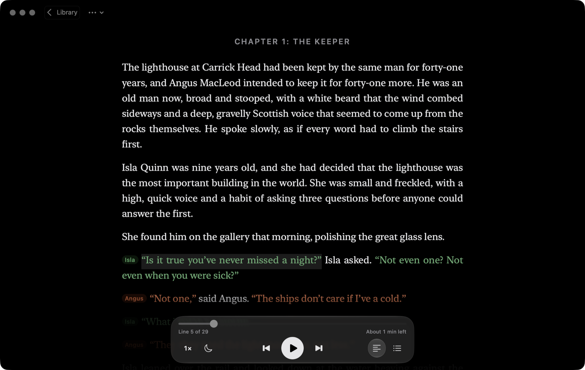

# RealBook

Reads books aloud with a different voice for every character. Each voice is picked to match how the book describes the character: an old Scottish lighthouse keeper with a gravelly voice gets an old, deep, slow Scottish voice, and a nine-year-old girl gets a higher, quicker one.

Everything runs on your own computer, for free and offline: natural-sounding Kokoro voices, optional designed voices made from each character's description (Qwen3-TTS, Mac), and the system voices as a fallback. No account or API key is needed.

**Website:** https://stanislav16.github.io/realbook · **Downloads:** [latest release](https://github.com/stanislav16/realbook/releases/latest)



## Install

- **Mac (Apple silicon, macOS 14+):** open `RealBook.dmg` and drag **RealBook** into **Applications**. The app isn't notarized, so the first time macOS refuses to open it: go to System Settings → Privacy & Security and click **Open Anyway**.
- **Windows 10/11 (64-bit):** unzip `RealBook-windows.zip` and run `RealBook.exe`. If SmartScreen warns about an unknown publisher, click **More info → Run anyway**. Windows has Kokoro and the Windows voices; designed voices and audiobook export are Mac-only for now.
- **Linux (64-bit; Ubuntu 22.04, Debian 12, Fedora 36 or newer):** run `tar -xzf RealBook-linux.tar.gz`, then `RealBook/RealBook`. Download the Kokoro voices when it offers them; with `espeak-ng` installed you also get its voices. Designed voices and audiobook export are Mac-only for now.

A short sample story is already in the library. Click **Add Book** (or drag a file onto the window) to import an `.epub` or `.txt`. Your books and the audio cache live in `~/Library/Application Support/RealBook` (Mac), `%APPDATA%\RealBook` (Windows) or `~/.local/share/RealBook` (Linux).

## Build the app

```bash
./packaging/build_app.sh                                  # Mac: dist/RealBook.app and dist/RealBook.dmg
uv run pyinstaller --noconfirm packaging/RealBook.spec    # Windows or Linux: dist/RealBook/RealBook[.exe]
```

The Mac app is about 490 MB, most of it the MLX runtime for designed voices; voice models are downloaded from inside the app. The Windows and Linux builds are made and tested on GitHub Actions (`.github/workflows/build.yml`) and attached to each release. No build is signed with a developer certificate yet.

`uv run realbook-selftest [--kokoro]` (or `RealBook --selftest` for a packaged app) imports the sample book and speaks a line with each available engine, in a temporary library.

## Develop

```bash
uv run realbook       # the app in a native window
uv run realbook-web   # the same UI in your browser at http://127.0.0.1:8765
```

## How it works

1. **Import**: splits the book into chapters, then into narration and quoted dialogue. Handles both “double” and ‘single’ (British) quote styles.
2. **Find the characters**: the free analyzer looks for speech tags (`said Angus`, `she whispered`, `the old man growled`) to learn who speaks. It reads the sentences around each name to infer gender, age, accent, voice pitch and speaking pace, and attributes every quote, including conversations where lines alternate without tags.
3. **Cast voices**: matches each character to an installed macOS voice by gender, age and accent. Pitch and speed are then adjusted from the description (deep vs. high voice, slow vs. quick talker). Characters who share a voice get different pitches so they still sound distinct.
4. **Read**: click any line to start there. The current line is highlighted, and audio for the next few lines is prepared ahead of time. Generated audio is cached on disk, so replays are instant.

## Using it

- **Library:** Reading Now, All Books and Finished in the sidebar. Covers come from the EPUB; books without one get a generated cover. Each book's ••• menu has Book Info, Update from File… (re-reads the cover and chapter names from the book's file and keeps your place) and Remove.
- **Books from Apple Books:** drag a book out of Apple Books onto the Desktop, then add it (or use it in Update from File…). Apple Books exports EPUBs as folders; RealBook reads those. Books bought in the Apple Books store are copy-protected and can't be read.
- **Reader:** **Aa** sets the theme (Original, Paper, Sepia, Gray, Night), font, text size, justification, and whether dialogue is coloured by character. The list button shows the table of contents; the people button shows the cast.
- **Menu bar (Mac):** RealBook → Settings… (⌘,) and Find Voice Models…, File → Add Book… (⌘O) and Library (⌘L), Playback → Next/Previous Chapter (⌘→/⌘←), Book → Show Contents (⌘1) / Show Cast (⌘2) / Export Audiobook…. On Windows, Settings and Find Voice Models are in the File menu.

## On your iPhone, phone or another computer

**The iPhone app** (with the Mac app). In RealBook on the Mac, open **Listen on iPhone** and scan the code from the iPhone app. It reads like the Mac and keeps your place in step with it; the Mac makes the voices, so designed voices work too. Whenever it can reach the Mac over Wi‑Fi, the iPhone saves the next 4 hours of the book you're listening to, so you can leave without planning ahead, and **Listen on iPhone** can also make a whole book into an offline copy for it.

The iPhone app isn't on the App Store yet. To install it (iOS 17 or later): open `ios/RealBook.xcodeproj` in Xcode, add your Apple ID in Xcode → Settings → Accounts, connect your iPhone, pick it as the destination and press ▶. The first time, turn on Settings → Privacy & Security → Developer Mode on the iPhone, and trust your Apple ID under Settings → General → VPN & Device Management. With a free Apple ID, Xcode has to install it again every 7 days.

**In a browser.** Any other phone, tablet or computer on the same Wi‑Fi can listen in its browser: scan the Mac's code with the camera, or on Windows and Linux turn on **Listen on Other Devices** in Settings and scan its QR code. The whole library opens, laid out for a small screen, and the computer makes the voices. Devices need the secret key in the link (a cookie remembers it); they can read, listen and change voices, but not change settings or open things on the computer. **New Code** (Mac) or **New Link** (Windows, Linux) cuts off every device paired so far, the iPhone too. The computer stays awake while something is playing, but it has to be on and on the same network.

**Take a book with you.** A book's ••• menu → **Export Audiobook…** (Mac) renders the whole book in the cast's voices into an `.m4b` audiobook with chapters, title, author and cover. It plays offline in Apple Books, BookPlayer, Smart AudioBook Player, VLC and other audiobook apps. Lines you've already listened to are reused; a long novel can take a few hours to make.

## Fixing things

- **Wrong speaker?** Click the coloured name tag in front of a quote and pick the right character, or create a new one. The Cast panel's ••• menu can also find the characters again, or hand the job to Claude.
- **Don't like a voice?** In the Cast panel, change the voice, pitch or speed. ▶ plays a sample line. Voices you set by hand are kept when you press **Re-cast**.
- Keyboard: `space` plays and pauses, `←` / `→` move one line.

## Voices

**Natural voices (Kokoro).** [Kokoro](https://huggingface.co/hexgrad/Kokoro-82M) is an open-source speech model that runs offline on your Mac, about 4× faster than real time on Apple Silicon. RealBook offers a one-time 354 MB download in the library (or in Settings); afterwards every book is re-cast automatically. It has 28 American and British voices. For large casts, RealBook also blends pairs of voices to create more distinct people, and shifts pitch for children and deep-voiced characters.

**Accents.** Kokoro only does American and British accents. By default, Scottish, Irish, Indian, Australian and South African characters keep a Mac voice in their own accent when one is installed. Turn this off in Settings to use Kokoro for everyone.

**Designed voices (Qwen3-TTS, optional).** [Qwen3-TTS](https://github.com/QwenLM/Qwen3-TTS) designs a voice from a written description, accents included. RealBook writes a description for each character from what the analyzer found ("An old man in his seventies with a deep, low voice and a Scottish accent. Speaks slowly and deliberately."); with Claude analysis, Claude's sentence about how they sound is added. The 1.7B VoiceDesign model speaks a short reference clip in that voice once, and the 0.6B Base model then clones that clip for every line, so a character sounds the same throughout. In the Cast panel you can rewrite any description (Use Description), ask for a different voice from the same description (New Take), or go back to the book's description (Reset). Download it from Settings (about 6.3 GB, Apple Silicon only); RealBook then switches to designed voices and re-casts every book. You can switch back to Kokoro in Settings at any time. It runs on the MLX port in [mlx-audio](https://github.com/Blaizzy/mlx-audio), about 2× faster than real time on an M5, roughly half Kokoro's speed. Each new voice takes about 8 seconds to design, so voices for the narrator and main characters are designed in the background when you open a book. Playback keeps up at up to about 1.75× speed. Every line is checked before it's kept: a short line must sound like its speaker (by voice fingerprint and pitch), and a small speech recogniser ([Parakeet 110M](https://huggingface.co/mlx-community/parakeet-tdt_ctc-110m), 459 MB, downloaded on its own the first time) hears where the words begin and end, so a take with a thump, click or stray syllables around them is made again.

**Finding newer models.** Open speech models improve quickly. **Find Voice Models…** (Settings, or the menu) lists text-to-speech models on Hugging Face, by trending, likes, downloads or release date, and marks what matters for RealBook: voice design, an MLX port that runs on a Mac, the licence, and which models RealBook already uses. Adding a new engine to RealBook still takes code; the list tells you which ones are worth it.

**Better Mac voices.** Apple's *Enhanced* and *Premium* voices sound much better than the default ones. Open **Settings** → **Open VoiceOver Utility**, then go to Speech → Voice → Customize… and download a few English voices. Pick the Premium version of each voice if there is one. To read entirely with Mac voices, choose "Mac system voices" in Settings.

## Describing characters with a local AI

The free analyzer guesses gender and age from words near a character's name, which goes wrong in long novels. In the Cast panel, ••• → **Describe Characters with Local AI…** has a small language model running on your Mac (Qwen3-4B, 2.3 GB, downloaded the first time; Apple silicon) read the passages about each of the 40 main characters and some of their lines. It decides gender, age, accent and how they sound ("gravelly, commanding", "with sly amusement"), and RealBook builds each voice description from that. Accents are only kept when the book mentions them. On Dune's 22 main characters it got every gender and 21 of 22 ages right (the free analyzer: 17 and 12). It takes a few seconds per character, and it changes only voices, never who says which line; voices and descriptions you set by hand are kept.

**Who says untagged lines.** About 40% of quotes in a novel like Dune have no speech tag ("said Paul"); the free analyzer then assumes speakers take turns, which fails when one person speaks several times in a row. ••• → **Find Speakers with Local AI…** has the same model read each scene and decide those lines. Lines with a tag, and lines you set by hand, are left alone. On two hand-labelled Dune chapters it got 92% of untagged lines right, against 66% for the free analyzer (a 9B model scored 93% at twice the time and size, so the small one is used). It takes about a minute per busy chapter, around 20–25 minutes for Dune, and you can keep listening meanwhile.

## Optional: Claude for character analysis

The free analyzer is rule-based. On long novels with many characters, it will leave some lines unattributed or give them to the wrong person. Claude reads the whole book and does this much more accurately.

To use it, paste an Anthropic API key into **Settings** (gear icon). The key is stored only on this Mac, in `settings.json` inside the data folder, readable only by your user. You can also set `ANTHROPIC_API_KEY` in the environment instead. Then click **Analyze with Claude** on a book. This costs roughly $1–3 per full novel in API usage.

## Files

- `realbook/importer.py`: EPUB / text import and chapter detection
- `realbook/segmenter.py`: splits narration from dialogue
- `realbook/heuristic.py`: free character discovery, profiling and quote attribution
- `realbook/claude_analyzer.py`: the same job done by Claude
- `realbook/local_analyzer.py`: character profiles from a small local language model (mlx-lm)
- `realbook/voices.py`: system voice catalogue and casting
- `realbook/kokoro_tts.py`: Kokoro model download, voice catalogue and synthesis
- `realbook/designed.py`: designed voices (Qwen3-TTS): model download, voice descriptions, voice design and cloning (on one MLX worker thread)
- `realbook/tts.py`: picks the engine (Qwen, Kokoro or a system voice) and caches audio
- `realbook/system.py`: what differs between macOS, Windows and Linux (data folder, system voices, audio files, opening things)
- `realbook/remote.py`: listening on other devices (second server, pairing key, QR code)
- `realbook/export.py`, `realbook/m4b.py`: audiobook export, and writing chapters and tags into the .m4b
- `realbook/model_finder.py`: the Hugging Face model search
- `realbook/selftest.py`: the smoke test used by the Windows and Linux builds
- `realbook/server.py`: local API; `realbook/static/`: the reader UI
- `realbook/app.py`: the native window (pywebview) that hosts the UI
- `packaging/`: app icons, PyInstaller spec, and `build_app.sh`
- `docs/`: the website (GitHub Pages)

## Licences

RealBook is free software under the [GNU GPL v3](LICENSE): the packaged app includes espeak-ng (GPL-3.0), which Kokoro uses for pronunciation. The Kokoro and Qwen3-TTS models are Apache 2.0; `kokoro-onnx` and `mlx-audio` are MIT. Only DRM-free books can be read.
